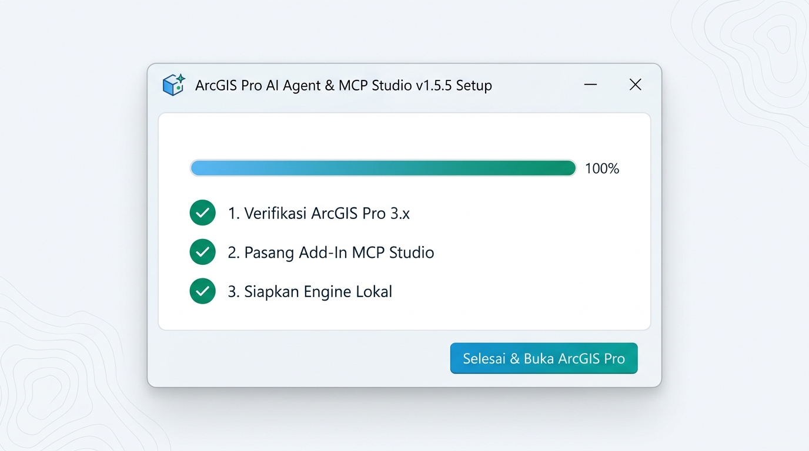
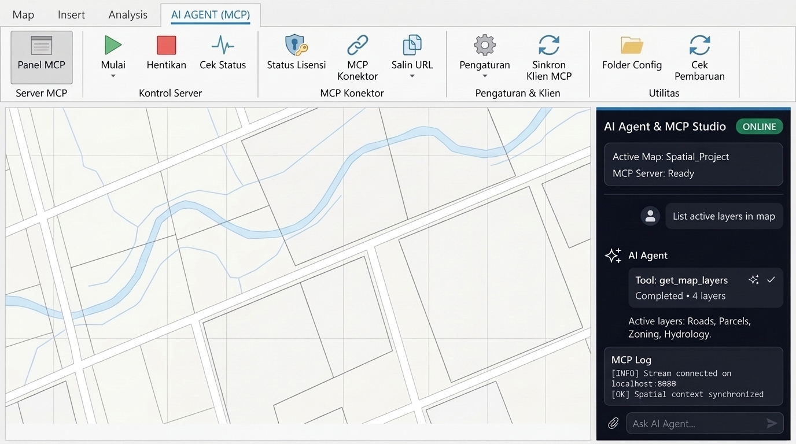
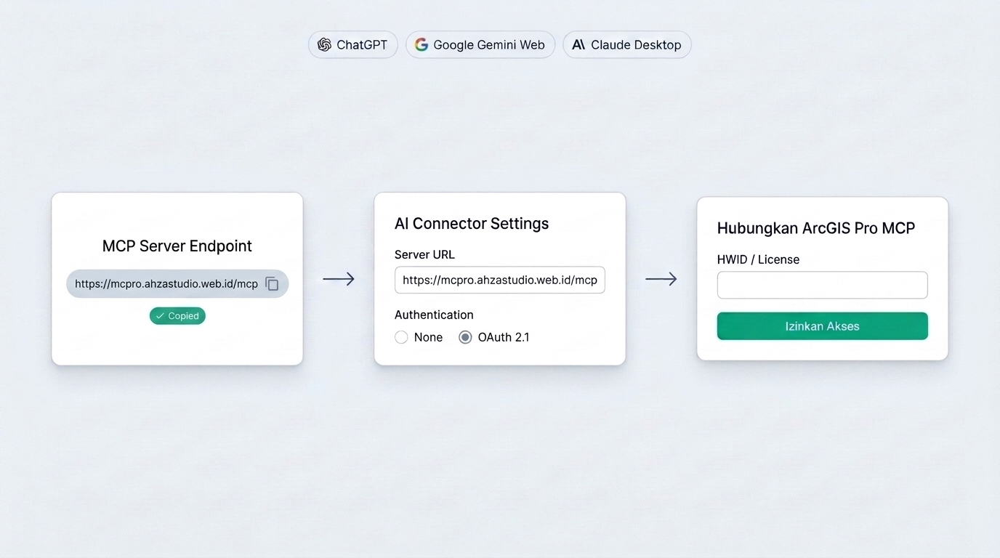
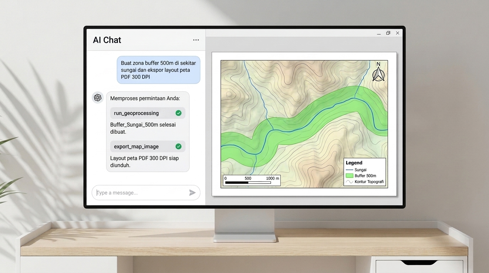

# Panduan Lengkap Instalasi & Penggunaan ArcGIS Pro AI Agent & MCP Studio v1.6.1

Dokumen ini memandu Anda mulai dari tahap instalasi Add-In pada Windows, pengenalan fungsi setiap tombol pada tab Ribbon **AI AGENT (MCP)**, penggunaan fitur **Paste & Upload Gambar (Multimodal)** di Panel AI Spatial Chat, cara menghubungkan ke berbagai asisten AI (ChatGPT, Google Gemini Web, Claude Desktop, Hermes Agent, Cursor, Google Antigravity, Gemini CLI, dan opencode), hingga penjelasan lengkap seluruh **43 tool spasial** (termasuk **Reverse Geocode, Elevasi DEM, Routing Jalan, & Service Area Isochrone gratis tanpa credit tambahan**) beserta contoh perintah siap pakai.

---

## 1. Spesifikasi & Persiapan Sistem

Pastikan perangkat Anda memenuhi prasyarat berikut sebelum memulai instalasi:

| Komponen | Kebutuhan Minimum | Keterangan |
| :--- | :--- | :--- |
| **Sistem Operasi** | Windows 10 atau Windows 11 (64-bit) | Berjalan secara native di lingkungan Windows x64. |
| **Perangkat Lunak GIS** | ArcGIS Pro 3.0 s/d 3.7+ | Mendukung seluruh level lisensi (Basic, Standard, Advanced). |
| **Ruang Penyimpanan** | 100 MB ruang kosong | Untuk paket installer, berkas Add-In, dan log aktivitas. |
| **Koneksi Internet** | Diperlukan saat awal & untuk AI Web | Untuk verifikasi lisensi perangkat dan koneksi ChatGPT/Gemini Web. |

> **Privasi Data Spasial:** File project (`.aprx`), geodatabase (`.gdb`), dan shapefile Anda tidak pernah diunggah ke server cloud mana pun. Seluruh pemrosesan peta dan analisis dieksekusi langsung di ArcGIS Pro pada komputer lokal Anda.

---

## 2. Cara Instalasi Add-In (Langkah Demi Langkah)

1. **Tutup Seluruh Jendela ArcGIS Pro:** Pastikan tidak ada sesi ArcGIS Pro yang masih aktif di latar belakang agar proses pemasangan Add-In berjalan mulus.
2. **Unduh dan Jalankan Installer:** Unduh file `ArcGISPro_AI_Studio_Setup.exe` dari halaman resmi [mcpro.ahzastudio.web.id](https://mcpro.ahzastudio.web.id/#unduh), lalu klik dua kali untuk menjalankannya. Jika muncul jendela peringatan Windows SmartScreen, klik **More info** lalu pilih **Run anyway**.
3. **Proses Otomatis 1-Klik:** Program instalasi akan mendeteksi direktori ArcGIS Pro Anda, memasang Add-In MCP Studio, menyiapkan komponen integrasi lokal, dan mengaktifkan masa **Free Trial 3 Hari** secara otomatis.
4. **Buka ArcGIS Pro:** Jalankan kembali ArcGIS Pro dan buka salah satu file project (`.aprx`). Tab menu baru bernama **AI AGENT (MCP)** akan langsung muncul pada bar Ribbon di bagian atas.

---

## 3. Mengenal Ribbon "AI AGENT (MCP)" & Panel Studio

Tab **AI AGENT (MCP)** tersusun ke dalam 5 kelompok tombol utama beserta 1 panel kerja (Dockpane) di sebelah kanan layar:

### Daftar Fungsi 11 Tombol Ribbon

| Kelompok | Nama Tombol | Fungsi Utama |
| :--- | :--- | :--- |
| **Server MCP** | **Panel MCP** | Membuka atau memfokuskan panel samping *AI Agent & MCP Studio* di sisi kanan layar ArcGIS Pro. |
| **Kontrol Server** | **Mulai Server** | Menyalakan server MCP lokal di dalam proses ArcGIS Pro (port default `9876`). |
| **Kontrol Server** | **Hentikan Server** | Mematikan layanan server MCP dan melepaskan port yang sedang dipakai. |
| **Kontrol Server** | **Cek Status** | Menampilkan dialog status terkini: status koneksi, port aktif, daftar jendela Pro, dan kontrol cepat. |
| **MCP Konektor** | **Status Lisensi** | Menampilkan Hardware ID (HWID) PC Anda, status paket aktif (Free Trial / Tahunan / Lifetime), dan masa berlaku. |
| **MCP Konektor** | **MCP Konektor** | Mengaktifkan jembatan konektor cloud agar AI Web (Gemini Web, ChatGPT, Claude, Hermes) dapat mengakses sesi Pro Anda. |
| **MCP Konektor** | **Salin URL MCP** | Menyalin alamat endpoint `https://mcpro.ahzastudio.web.id/mcp` langsung ke clipboard. |
| **Pengaturan & Klien** | **Pengaturan** | Mengatur Host, Port, menyalin atau memperbarui Token otentikasi, mengaktifkan Auto-Start, serta membuka folder konfigurasi dan log. |
| **Pengaturan & Klien** | **Sinkron Klien MCP** | Menambahkan entri `arcgis-pro` ke konfigurasi klien AI desktop lokal (Google Antigravity, Claude Desktop, Cursor, Gemini CLI, opencode) tanpa menimpa server lain. |
| **Utilitas** | **Folder Config** | Membuka folder penyimpanan data lokal di Windows Explorer. |
| **Utilitas** | **Cek Pembaruan** | Memeriksa pembaruan versi terbaru beserta catatan rilis dan tombol instalasi pembaruan langsung. |

### Mengenal Panel AI Agent & MCP Studio (Dockpane)

- **Tab AI Spatial Chat:** Ruang percakapan langsung di dalam ArcGIS Pro untuk mengetik instruksi analisis peta tanpa berpindah aplikasi. Mulai **v1.6.x**, panel chat mendukung:
  - **Paste Gambar Instan (`Ctrl+V`):** Tempel langsung tangkapan layar peta, layout, atau tabel dari Snipping Tool / Clipboard ke kotak chat.
  - **Tombol Lampirkan Gambar & Drag-Drop:** Unggah file `.png`, `.jpg`, `.jpeg`, `.bmp`, atau `.webp` lengkap dengan strip preview thumbnail sebelum dikirim.
  - **Eksekusi 1 Langkah & Layout View Aware:** AI otomatis mengetahui active view, daftar layer, CRS, nama field, dan daftar layout sehingga langsung mengeksekusi aksi utama tanpa bolak-balik inspeksi.
- **Tab Server & Log:** Memantau indikator status (`ONLINE` / `OFFLINE`), project serta map yang sedang aktif, dan catatan riwayat eksekusi tool secara langsung.

---

## 4. Cara Menghubungkan ke Asisten AI

Gunakan satu URL endpoint yang sama untuk seluruh asisten AI berbasis web maupun desktop modern:
`https://mcpro.ahzastudio.web.id/mcp`

### A. Google Gemini Web (`gemini.google.com`)
1. Pastikan **Mulai Server** dan **MCP Konektor** aktif di tab **AI AGENT (MCP)** ArcGIS Pro.
2. Buka **gemini.google.com**, masuk ke **Setelan** > **Aplikasi terhubung** (atau *Konektor*), lalu pilih **Tambahkan aplikasi kustom (Terhubung ke server MCP)**.
3. Masukkan URL `https://mcpro.ahzastudio.web.id/mcp`. Biarkan bagian Setelan Tambahan kosong (atau isi `Client ID: arcgispro-gemini` dan `Rahasia klien: ahzastudio-mcp-oauth` bila wajib diisi).
4. Klik **Berikutnya**. Ketika jendela OAuth Pairing terbuka, masukkan **HWID PC** atau **License Key** Anda dan klik **Izinkan Akses**.

### B. OpenAI ChatGPT (Desktop / Web)
1. Buka menu **Plugins / Apps** > **Add custom MCP server**.
2. Isi Name: `ArcGIS Pro MCP`, MCP Server URL: `https://mcpro.ahzastudio.web.id/mcp`, dan pada bagian Authentication pilih **OAuth**.
3. Masukkan **HWID PC** Anda pada layar pairing yang terbuka lalu klik **Hubungkan**.

### C. Claude Desktop
- **Mode Online (Connectors):** Klik ikon **+** di kotak chat > **Connectors** > **Add custom connector**, tempelkan URL `https://mcpro.ahzastudio.web.id/mcp` dan selesaikan otorisasi HWID di browser.
- **Mode Lokal (Offline):** Klik **Sinkron Klien MCP** di Ribbon ArcGIS Pro, lalu restart Claude Desktop.

### D. Hermes Agent
1. Masuk ke tab **Connectors** > **+ Connect to a custom MCP**.
2. Isi Name: `ArcGISPro MCP`, Type: **Streamable HTTP**, URL: `https://mcpro.ahzastudio.web.id/mcp`, dan Auth: **OAuth** (atau Bearer Token berisi HWID PC). Klik **Save**.

### E. Cursor, Google Antigravity, Gemini CLI & opencode
1. Klik **Sinkron Klien MCP** pada tab **AI AGENT (MCP)** di ArcGIS Pro.
2. Tutup dan buka kembali aplikasi AI pilihan Anda agar konfigurasi baru langsung aktif.

---

## 5. Penjelasan & Contoh Penggunaan 43 Tools Spasial

### A. Koneksi & Server (4 Tool)
1. **`ping_arcgis`**: Mengecek apakah server MCP ArcGIS Pro aktif dan siap menerima perintah.
   - *Contoh prompt:* "Cek apakah koneksi ke ArcGIS Pro sudah aktif."
2. **`diagnose_connection`**: Membaca diagnostik lengkap mulai dari versi Pro, project, map aktif, layer, hingga daftar instance.
   - *Contoh prompt:* "Lakukan diagnosa lengkap koneksi dan status project ArcGIS Pro saya."
3. **`list_instances`**: Melihat semua sesi jendela ArcGIS Pro yang sedang berjalan beserta port masing-masing.
   - *Contoh prompt:* "Tampilkan semua jendela ArcGIS Pro yang sedang aktif saat ini."
4. **`stop_server`**: Menghentikan server MCP lokal di dalam ArcGIS Pro bila diminta oleh pengguna.
   - *Contoh prompt:* "Hentikan server MCP di ArcGIS Pro sekarang."

### B. Project & Informasi Peta (5 Tool)
5. **`get_project_info`**: Membaca nama project `.aprx`, path default geodatabase, active view (Map/Layout), daftar map, dan daftar layout.
   - *Contoh prompt:* "Tampilkan info project aktif dan lokasi default geodatabase-nya."
6. **`save_project`**: Menyimpan perubahan terbaru pada project `.aprx` yang terbuka.
   - *Contoh prompt:* "Simpan semua perubahan pada project ArcGIS Pro saya."
7. **`list_maps`**: Mendaftar seluruh Map dan Scene yang ada di dalam project.
   - *Contoh prompt:* "Sebutkan seluruh map yang tersedia di project ini."
8. **`get_active_map`**: Membaca detail peta aktif meliputi sistem koordinat (CRS), skala, extent, dan jumlah layer.
   - *Contoh prompt:* "Jelaskan sistem koordinat dan skala dari map yang sedang aktif."
9. **`get_map_extent`**: Mengambil koordinat bounding box kamera aktif (`xmin`, `ymin`, `xmax`, `ymax`) dan skala.
   - *Contoh prompt:* "Catat batas koordinat extent dan skala tampilan peta saya saat ini."

### C. Navigasi, Lokasi & Elevasi (5 Tool — 2 Baru v1.6.1)
10. **`zoom_to_location`**: Mengarahkan dan zoom kamera peta ke kecamatan, desa, kota, atau landmark berdasarkan nama tempat.
    - *Contoh prompt:* "Arahkan tampilan peta ke Kecamatan Kusan Hilir, Kabupaten Tanah Bumbu."
11. **`geocode_location`**: Mencari koordinat lintang/bujur dan batas wilayah nama tempat tanpa menggeser tampilan peta.
    - *Contoh prompt:* "Carikan koordinat geodetik dan extent untuk Kota Balikpapan."
12. **`reverse_geocode`** *(Baru v1.6.1)*: Mengubah koordinat (`latitude`, `longitude`) atau fitur layer titik di ArcGIS Pro menjadi alamat lengkap (jalan, desa, kecamatan, kota, provinsi) tanpa biaya kredit tambahan, dan opsional langsung menulis ke kolom teks seperti `ALAMAT`.
    - *Contoh prompt:* "Isi kolom ALAMAT pada semua titik di layer Titik_Patok menggunakan reverse geocode."
13. **`get_elevation`** *(Baru v1.6.1)*: Mengambil ketinggian mdpl untuk titik koordinat, batch fitur layer, atau profil elevasi sepanjang garis tanpa biaya kredit tambahan (prioritas membaca Raster DEM lokal di Pro, otomatis fallback DEM 30m global gratis), plus opsi simpan ke field `ELEVASI_M`.
    - *Contoh prompt:* "Ambil data ketinggian elevasi mdpl untuk seluruh titik di layer Titik_Patok dan simpan ke field ELEVASI_M."
14. **`zoom_to_layer`**: Melakukan zoom kamera agar pas menampilkan cakupan layer tertentu atau fitur terpilih saja.
    - *Contoh prompt:* "Zoom peta ke cakupan layer Batas_Desa."

### D. Manajemen Layer & Kueri Atribut (7 Tool)
15. **`get_layers`**: Mendaftar semua layer di peta aktif beserta visibilitas, jumlah fitur, status label, dan daftar field ringkas.
    - *Contoh prompt:* "Tampilkan daftar semua layer yang aktif beserta jumlah fiturnya."
16. **`find_layer`**: Mencari layer di daftar peta menggunakan kata kunci sebagian atau persis.
    - *Contoh prompt:* "Cari layer yang mengandung kata Jalan pada peta aktif."
17. **`get_layer_details`**: Membaca struktur kolom tabel atribut (nama, alias, tipe, panjang), tipe geometri, CRS, dan filter aktif layer.
    - *Contoh prompt:* "Periksa daftar nama kolom atribut dari layer Persil_Lahan."
18. **`add_layer_to_map`**: Memuat file `.shp`, feature class `.gdb`, raster `.tif`, `.geojson`, atau URL layanan ke peta.
    - *Contoh prompt:* "Tambahkan file D:/DataGIS/Sungai.shp ke dalam peta aktif."
19. **`remove_layer_from_map`**: Menghapus layer tertentu dari daftar isi peta setelah konfirmasi pengguna.
    - *Contoh prompt:* "Hapus layer sementara Buffer_Temp dari tampilan peta."
20. **`set_layer_visibility`**: Menampilkan atau menyembunyikan layer pada peta.
    - *Contoh prompt:* "Sembunyikan layer Jalan_Lokal dan tampilkan layer Batas_Kecamatan."
21. **`query_layer_features`**: Menyaring isi tabel atribut layer memakai filter SQL (seperti `Luas_Ha > 5`).
    - *Contoh prompt:* "Ambil 10 data teratas dari layer Persil dengan Luas_Ha lebih dari 5."

### E. Menu Layer, Simbologi, Seleksi, Field & Ekspor Data (5 Tool)
22. **`set_layer_symbology`**: Mengatur simbologi layer dalam 1 langkah (`single`, `unique_values`, `graduated_colors`), warna fill/hollow, outline, ukuran simbol, bentuk marker, serta transparansi.
    - *Contoh prompt:* "Ubah simbologi layer Persil_Tanah menjadi hollow dengan outline merah tebal 2 pt."
23. **`select_layer_features`**: Menjalankan seleksi fitur lengkap (`by_attribute`, `by_location`, `switch`, `clear`, `all`, `status`) serta opsi langsung `zoom_to_selected`.
    - *Contoh prompt:* "Pilih semua fitur pada layer Persil_Tanah dengan Luas_Ha lebih dari 5 lalu zoom ke fitur terpilih."
24. **`manage_layer_fields`**: Mengelola Data Design & Field Calculator (`list`, `add`, `calculate`, `alter`, `delete`) termasuk shortcut Geodesic otomatis (`AREA_HA`, `AREA_M2`, `LENGTH_M`, `POINT_X`, `POINT_Y`).
    - *Contoh prompt:* "Tambahkan field Luas_Ha bertipe DOUBLE pada layer Persil_Tanah lalu hitung luasnya secara geodesic dalam hektar."
25. **`set_layer_properties`**: Mengatur properti layer langsung (`definition_query`, `transparency`, `min_scale`, `max_scale`, `new_name`, `show_popups`).
    - *Contoh prompt:* "Atur Definition Query layer Jalan menjadi KELAS = 'Arteri' dengan transparansi 20%."
26. **`export_layer_data`**: Mengekspor data layer ke `.shp`, `.gdb`, `.geojson` (`export_features`), tabel `.csv`/`.dbf` (`export_table`), Excel `.xlsx` (`export_excel`), atau mengganti sumber data (`set_data_source`).
    - *Contoh prompt:* "Ekspor tabel atribut layer Titik_Patok ke file Excel D:/Output/Daftar_Koordinat.xlsx."

### F. Joins, Relates, Routing & Service Area (4 Tool — 2 Baru v1.6.1)
27. **`spatial_join`**: Melakukan Spatial Join 1 langkah (`INTERSECT`, `WITHIN`, `CONTAINS`, `CLOSEST`, `HAVE_THEIR_CENTER_IN`, dll.) ke output feature class baru dengan laporan jumlah fitur cocok.
    - *Contoh prompt:* "Lakukan Spatial Join antara layer Titik_Patok dengan Batas_Desa menggunakan operasi INTERSECT dan simpan ke output baru."
28. **`attribute_join`**: Menjalankan Joins & Relates penuh (`temporary`, `permanent`, `remove`, `remove_all`, `add_relate`, `remove_relate`, `remove_all_relates`).
    - *Contoh prompt:* "Gabungkan atribut tabel Data_Pemilik.csv ke layer Persil_Tanah berdasarkan field ID_PERSIL secara permanen."
29. **`solve_route`** *(Baru v1.6.1)*: Menghitung rute perjalanan jalan raya nyata (`driving`, `cycling`, `walking`) dari nama tempat, koordinat, atau layer titik di Pro, mengembalikan jarak km, durasi tempuh, arahan belokan, dan otomatis membuat Feature Layer Polyline rutenya di peta tanpa kredit tambahan.
    - *Contoh prompt:* "Buatkan rute berkendara dari Balikpapan menuju Sepaku IKN dan tampilkan layer garis rutenya di peta."
30. **`solve_service_area`** *(Baru v1.6.1)*: Membuat poligon Service Area / Isochrone area jangkauan berbasis waktu tempuh jalan nyata (`minutes`) atau jarak (`kilometers`) dan langsung memasukkannya sebagai Feature Layer Poligon bertingkat di ArcGIS Pro tanpa kredit tambahan.
    - *Contoh prompt:* "Buat service area jangkauan berkendara 5, 10, dan 15 menit dari layer Puskesmas dan hitung luas tiap zona dalam hektar."

### G. Geoprocessing Cerdas, Lisensi & Topologi (6 Tool)
31. **`get_arcgis_license_info`**: Memeriksa level lisensi Pro (Basic/Standard/Advanced), status ekstensi, dan daftar tool fallback.
    - *Contoh prompt:* "Cek level lisensi ArcGIS Pro saya dan ekstensi analisis yang tersedia."
32. **`search_geoprocessing_tools`**: Mencari nama resmi tool Geoprocessing dari semua toolbox yang terpasang.
    - *Contoh prompt:* "Cari seluruh tool geoprocessing untuk analisis zonal statistics."
33. **`get_geoprocessing_tool_help`**: Membaca urutan parameter wajib, opsional, tipe data, dan pilihan domain sebelum eksekusi.
    - *Contoh prompt:* "Tampilkan panduan parameter tool Buffer_analysis sebelum saya jalankan."
34. **`check_geometry_topology`**: Mengecek kesehatan geometri (NULL/empty/luas nol), cek validitas CRS, serta opsi perbaikan (`RepairGeometry`).
    - *Contoh prompt:* "Periksa validitas geometri dan sistem koordinat pada layer Persil_Tanah."
35. **`checkpoint_state`**: Membuat, melihat, atau memulihkan snapshot kondisi peta (layer, filter, kamera) sebagai tombol Undo aman sebelum proses besar.
    - *Contoh prompt:* "Buat checkpoint dengan label Sebelum Analisis Buffer."
36. **`run_geoprocessing`**: Menjalankan tool GP apa saja (termasuk custom `.atbx`/`.tbx`) dengan proteksi satuan jarak CRS dan adaptasi otomatis di lisensi Basic/Standard.
    - *Contoh prompt:* "Jalankan Buffer_analysis sejauh 500 Meters pada layer Sungai dan tampilkan di peta."

### H. Kartografi, Label, Tabel Layout & Ekspor Peta (5 Tool)
37. **`set_layer_label`**: Mengatur label multi-baris, bold parsial, satuan (Ha/m2/km), kontrol desimal, halo putih, alignment, hingga konversi ke Annotation dalam 1 perintah.
    - *Contoh prompt:* "Pada layer Persil_Tanah, buat label 2 baris: Nama di atas dengan font tebal dan Luas_Ha di bawah tidak tebal satuan Ha tanpa desimal."
38. **`add_table_to_layout`**: Menambahkan `TableFrame` daftar koordinat atau atribut ke Layout aktif/tertentu dengan pencocokan field cerdas (X/Y), auto-sort KODE/ID, latar putih, dan border rapi.
    - *Contoh prompt:* "Buatkan tabel daftar koordinat dari layer Titik_Patok memakai field KODE, X, dan Y lalu tambahkan ke layout aktif."
39. **`export_map_image`**: Mengekspor tampilan peta yang sedang aktif ke gambar PNG, JPG, TIF, atau PDF.
    - *Contoh prompt:* "Ekspor tampilan peta saat ini ke gambar PNG 200 DPI."
40. **`create_layout`**: Membuat halaman layout lengkap dengan Map Frame, judul, subjudul, legenda, skala bar, arah utara, catatan kaki, dan ekspor langsung ke PDF/gambar.
    - *Contoh prompt:* "Buatkan layout A4 landscape berjudul Peta Zona Sempadan Sungai lengkap dengan legenda dan skala bar, lalu ekspor ke PDF 300 DPI."
41. **`list_layouts`**: Menampilkan daftar seluruh layout yang ada di project beserta ukuran kertas dan elemennya.
    - *Contoh prompt:* "Daftar semua layout peta yang sudah tersimpan di project ini."

### I. Otomasi Python ArcPy & Antrean Job (2 Tool)
42. **`run_python`**: Menjalankan skrip Python ArcPy penuh langsung di dalam sesi ArcGIS Pro aktif (dapat membaca data & edit yang belum di-save).
    - *Contoh prompt:* "Jalankan skrip ArcPy untuk menghitung total luas seluruh poligon pada layer Lahan_Aktif dalam satuan hektar."
43. **`get_job_status`**: Memantau perkembangan operasi analisis berat yang dijalankan secara asynchronous (`async_run=True`).
    - *Contoh prompt:* "Cek status job analisis berat terakhir apakah sudah selesai."

---

## 6. Lisensi & Pemecahan Masalah

- **Masa Uji Coba (Free Trial):** Berlaku otomatis selama **3 hari** sejak instalasi pertama di perangkat Anda.
- **Upgrade Paket Tahunan atau Lifetime:** Klik tombol **Status Lisensi** pada tab **AI AGENT (MCP)** untuk menyalin **HWID PC**, lalu kirimkan ke Admin WhatsApp (`0851-5622-0008`) guna proses aktivasi.
- **Kendala Koneksi:** Pastikan ArcGIS Pro dalam kondisi terbuka bersama sebuah file project `.aprx`, dan tombol **Mulai Server** di tab **AI AGENT (MCP)** sudah ditekan hingga Panel MCP menampilkan status **ONLINE**.
